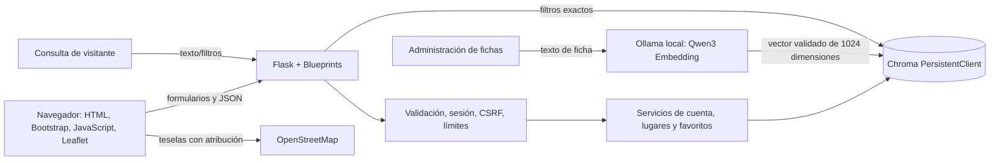

# Arquitectura de la aplicación

## Implementado en el MVP actual

Aplicación Flask monolítica y modular: Blueprints separan el catálogo, autenticación, administración, favoritos y estado del servicio. Jinja sirve páginas HTML; tres rutas adicionales devuelven JSON para lectura y búsqueda tradicional. Chroma es el único almacén persistente. No se usa PostgreSQL, PostGIS ni pgvector.

La búsqueda tradicional no llama a Ollama. Agregar una ficha sí lo requiere para construir el embedding que se guarda en la colección. El texto de la consulta todavía se busca por coincidencia textual, no por distancia vectorial.

## Organización del código

- `app/routes/`: páginas HTML, API JSON, autenticación, administración y favoritos.
- `app/services/`: acceso a Chroma, hashes, embeddings y operaciones de negocio.
- `app/templates/` y `app/static/`: interfaz web.
- `tests/`: pruebas con una instancia Chroma temporal.
- `docs/`: contratos y decisiones compartidas.

## Colecciones y datos

- Lugares usan una colección versionada por embedding: `lugares_qwen3_embedding_0_6b_v1`.
- Catálogo (metadatos), usuarios y favoritos están en colecciones independientes y se consultan por IDs/metadatos. Usan un vector centinela unidimensional que no participa en búsquedas semánticas. Una colección versionada separada contiene solo embeddings Qwen reales.
- Las búsquedas y explicaciones de la interfaz usan metadatos del catálogo; los estados pendientes no se exponen públicamente.
- Las categorías son slugs controlados por el servidor. No hay SQL ni entrada que pueda convertirse en una consulta libre.

Chroma no impone claves foráneas, unicidad relacional ni transacciones entre colecciones. Las referencias y el correo único se validan en código. Esta decisión es adecuada para el MVP de un equipo pequeño, pero requiere pruebas de concurrencia y considerar PostgreSQL si la escritura multiusuario crece.

## Geografía y mapa

El MVP guarda latitud y longitud opcionales como metadatos y solo muestra marcadores de fichas publicadas. El botón de ubicación pide permiso tras una acción del visitante; las coordenadas del navegador no se envían al servidor. No hay filtros por radio, PostGIS, cálculo de rutas ni búsqueda por cercanía.

Los mosaicos de mapa vienen de OpenStreetMap y llevan atribución. Para tráfico considerable debe elegirse y configurarse un proveedor según sus políticas de uso; el servidor público de mosaicos no es un CDN garantizado.

## Integración IA por fases

**Hoy:** Ollama con Qwen3 Embedding crea el vector de una ficha cuando administración la guarda. `GEMMA_MODEL` está configurada, pero Gemma no está conectada todavía. No hay búsqueda semántica.

**Siguiente fase:** crear un servicio Gemma que convierta consulta en un esquema estricto validado; el backend permitirá solo categorías, presupuesto, ambiente y duración dentro de rangos definidos. El modelo nunca obtiene una conexión a Chroma, no produce SQL/IDs/coordenadas ni inventa resultados. Los filtros obligatorios los valida el backend; la recuperación consulta fichas verificadas y la explicación se construye solo con resultados recuperados. Si Ollama/Gemma falla, se usa búsqueda tradicional.

Antes de comparar vectores, el servicio debe validar el modelo y dimensión guardados en metadatos. Un índice nuevo debe tener colección versionada diferente; no se mezclan modelos en la misma colección.

## Ejecución y persistencia

`CHROMA_PATH` controla dónde persiste el almacén. La colección de catálogo admite creación y búsqueda tradicional sin Ollama; la colección vectorial contiene solo embeddings generados correctamente. El comando `generar-embeddings` reintenta fichas pendientes. Docker Compose monta un volumen y ejecuta Gunicorn con un worker. No se publica un puerto de base de datos ni un servidor Chroma HTTP. No se debe ejecutar más de un proceso contra el mismo directorio persistente sin validar el modo de concurrencia y bloqueo.

## Seguridad y límites conocidos

- Formularios POST usan token CSRF; credenciales se guardan mediante hash `scrypt` de Werkzeug.
- Cookie HTTP-only, SameSite Lax y límites de frecuencia en login/registro.
- El rol admin se comprueba en backend.
- Los campos de entrada se validan antes de acceder a Chroma; Jinja escapa contenido al renderizar.
- Se guardan URLs de foto y se muestran enlaces externos; no existe carga de archivos.
- El limitador actual usa memoria del proceso, suficiente para ejecución local con un worker, no para despliegue con varios workers.
- Chroma debe mantenerse como cliente embebido local en esta etapa. Revisar el aviso de seguridad publicado para la versión fijada antes de exponer la aplicación a una red pública.

## Referencias

- [Chroma Persistent Client](https://docs.trychroma.com/reference/python/client)
- [Filtros de metadatos Chroma](https://docs.trychroma.com/docs/querying-collections/metadata-filtering)
- [API de embeddings de Ollama](https://github.com/ollama/ollama/blob/main/docs/capabilities/embeddings.mdx)
- [Aviso de seguridad de Chroma](https://github.com/advisories/GHSA-f4j7-r4q5-qw2c)
