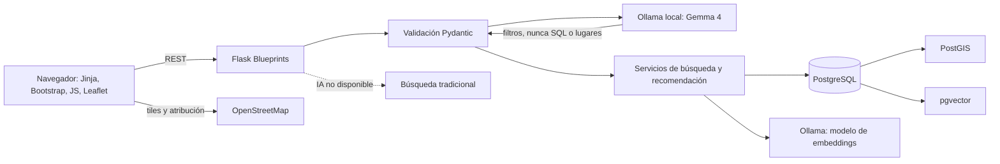

# Arquitectura inicial

## Decisión

El MVP será un monolito modular con Flask, Jinja2 y una API REST JSON. La base de datos principal es PostgreSQL con PostGIS y pgvector. Ollama se ejecuta fuera de los contenedores de la aplicación y se configura mediante `OLLAMA_URL`.

## Límites

- La interfaz inicial es una maqueta estática, servida desde Flask en `/`.
- `/health/live` confirma que el proceso responde; no comprueba la base de datos.
- Aún no hay modelos SQLAlchemy, endpoints de catálogo, autenticación ni integración de Ollama.
- Las búsquedas tradicionales deberán seguir disponibles sin Ollama.
- Las coordenadas del visitante se usarán bajo consentimiento y no se persistirán por defecto.

## Base de datos local

Se usa PostgreSQL 17 con PostGIS 3.5 a través de `postgis/postgis:17-3.5`. El Dockerfile deriva esa imagen y compila pgvector `v0.8.7`, usando la pauta de compilación publicada por el proyecto pgvector. PostGIS proporciona las funciones geográficas; pgvector permite almacenar vectores junto a las fichas.

Referencias: [imagen PostGIS](https://hub.docker.com/r/postgis/postgis), [pgvector](https://github.com/pgvector/pgvector) y [Dockerfile de compilación de pgvector](https://github.com/pgvector/pgvector/blob/master/Dockerfile).
