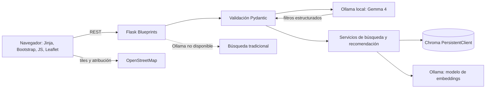

# Arquitectura inicial

## Decisiones del MVP

- Monolito modular con Flask, Jinja2 y API REST JSON.
- Chroma será el único almacén de datos de la aplicación en esta etapa. No se usarán PostgreSQL, PostGIS ni pgvector.
- El MVP no filtra resultados por radio o distancia. Las coordenadas opcionales solo sirven para colocar marcadores en el mapa y centrarlo si la persona comparte su ubicación.
- Chroma se ejecuta como `PersistentClient` dentro del proceso Flask y guarda sus archivos en un volumen persistente. No se publica un servidor Chroma HTTP.
- Gemma y el modelo de embeddings se ejecutan localmente con Ollama. Si Ollama falla, la búsqueda tradicional debe seguir disponible.

## Colecciones y límites

- `lugares_qwen3_embedding_0_6b_v1`: fichas de lugares, metadatos estructurados y embeddings de sus textos verificados.
- Colecciones adicionales para categorías, usuarios, favoritos, preferencias u opiniones se crearán cuando esas funciones entren al MVP. Chroma no tiene claves foráneas ni transacciones entre colecciones; el backend deberá validar referencias e identidad antes de escribir.
- Nunca se crea una colección ni una función de embeddings usando valores suministrados por el usuario. Los embeddings se generan mediante una llamada explícita a Ollama.
- Las colecciones de embeddings llevan el modelo y versión en sus metadatos. Si cambia el modelo o dimensión, se crea una colección versionada nueva y se reindexan documentos; no se mezclan vectores.
- Los filtros de categoría, presupuesto y verificación se aplican en el backend mediante metadatos `where`. Chroma admite filtros de metadatos y comparaciones numéricas; la distancia geográfica no forma parte de este alcance.

## Estado actual

- La interfaz es una maqueta estática servida desde `/`.
- `/health/live` confirma que Flask responde; no comprueba Chroma ni Ollama.
- La conexión Chroma se crea de forma perezosa al solicitarla, para que la maqueta pueda arrancar aunque el almacenamiento no se haya inicializado.
- Aún no hay catálogo, autenticación, endpoints de búsqueda ni integración de Ollama.

## Persistencia y ejecución

El modo local usa `chromadb.PersistentClient` y `CHROMA_PATH`. Docker Compose monta un volumen llamado `chroma_data` dentro del contenedor Flask. Se usa un proceso Gunicorn porque un cliente persistente embebido no debe abrir el mismo directorio desde varios workers.

La documentación oficial recomienda `PersistentClient` para desarrollo y pruebas y un servidor Chroma para producción. Para el MVP se prioriza ejecución local sin exponer un puerto de base de datos. Antes de despliegue multiusuario se debe revisar el estado de seguridad de Chroma, elegir un servicio HTTP protegido y probar concurrencia y copias de seguridad.

## Seguridad conocida

Al 31 de octubre de 2026, la versión estable publicada que se fijó en `requirements.txt` es Chroma 1.5.9. El proyecto Chroma mantiene avisos abiertos para esa versión, incluida una vulnerabilidad relacionada con creación de colecciones y `trust_remote_code`, además de avisos para ciertos modos de autenticación/autorización del servidor. Por eso, este prototipo no arranca el servidor HTTP de Chroma, no permite definir funciones de embeddings desde peticiones y genera vectores con Ollama. No se debe exponer este prototipo a Internet. Hay que revisar avisos y versiones corregidas antes de una demo pública o despliegue.

## Referencias

- [Clientes Python de Chroma](https://docs.trychroma.com/reference/python/client)
- [Filtros de metadatos de Chroma](https://docs.trychroma.com/docs/querying-collections/metadata-filtering)
- [Aviso de seguridad CVE-2026-45829 en GitHub Advisory Database](https://github.com/advisories/GHSA-f4j7-r4q5-qw2c)
- [Releases de Chroma](https://github.com/chroma-core/chroma/releases)
