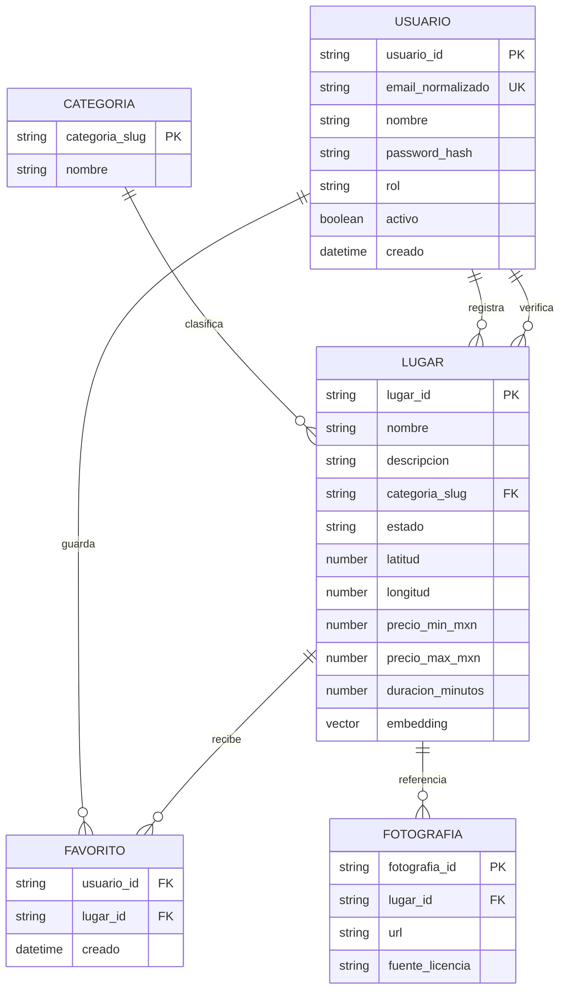

# Modelo de datos actual

El almacenamiento de este MVP es Chroma. Las tablas y relaciones SQL que aparecían en el alcance original no están implementadas: no hay PostgreSQL, PostGIS, pgvector ni migraciones SQL.

## Relaciones conceptuales

El diagrama expresa las relaciones que valida la aplicación; Chroma no crea ni hace cumplir claves foráneas. Las categorías actuales son constantes del servidor, no una colección administrable. Las fotografías son URLs, no archivos cargados; cada URL de foto requiere una fuente/licencia.

## Colecciones físicas

| Colección | Clave | Campos principales | Uso |
|---|---|---|---|
| `lugares_catalogo_v1` | UUID del lugar | Nombre, descripción, categoría, estado, fuente, ubicación opcional, precio/duración/etiquetas, estado de embedding | Catálogo y búsqueda tradicional, funciona aunque Ollama esté apagado. |
| `lugares_qwen3_embedding_0_6b_v1` | Mismo UUID del lugar | Documento, metadatos de filtro, embedding Qwen real de 1024 dimensiones | Índice vectorial separado; solo contiene registros cuyo embedding se generó correctamente. |
| `usuarios_v1` | UUID de usuario | Nombre, correo normalizado, hash, rol, estado activo, fecha | Login y autorización. |
| `favoritos_v1` | `usuario_id:lugar_id` | ID de usuario, ID de lugar, fecha | Lectura exacta por usuario y alternancia de favorito. |

El catálogo, las cuentas y favoritos tienen un embedding centinela `[0.0]` solo porque Chroma almacena registros en colecciones vectoriales. Nunca se comparan semánticamente ni comparten colección con los embeddings Qwen de lugares. El índice Qwen almacena únicamente vectores reales del modelo configurado.

## Reglas de datos

- Los IDs se generan en backend; las categorías son slugs definidos en `app/constants.py`.
- La ficha tiene estado `pendiente` o `verificado`. Solo la segunda se muestra en el catálogo y APIs públicas.
- Una fuente `http`/`https` es obligatoria al publicar o verificar una ficha. El admin debe comprobar que respalda los datos.
- Precio mínimo y máximo se guardan juntos; precio máximo es el utilizado como límite estricto de búsqueda. Si falta, el precio es desconocido.
- Coordenadas, horarios, contacto y fotografía son opcionales; ausencia se muestra como desconocida, no se completa con datos supuestos.
- Si Ollama no está disponible, el registro se guarda con `embedding_status=pendiente` en el catálogo y continúa funcionando en búsqueda tradicional. `python -m flask --app run:app generar-embeddings` reintenta su índice cuando Ollama vuelve.
- El embedding de lugar es generado por Ollama con `qwen3-embedding:0.6b`. La colección vectorial registra modelo, dimensión y versión de esquema.
- El endpoint de Ollama se valida para que produzca exactamente la dimensión configurada y valores numéricos finitos.

## Integridad y límites

Chroma no ofrece restricciones únicas, joins o transacciones relacionales. El backend comprueba que el correo no exista y valida lugar y usuario antes de guardar favoritos; todavía queda riesgo de carrera en registros simultáneos. Esta base sirve para demo pequeña. Antes de abrir registros/escrituras en producción hay que evaluar el almacén transaccional, concurrencia, borrado de usuario, exportación y backups.

No se cargan lugares ficticios como semilla. Las pruebas usan registros sintéticos aislados en una carpeta temporal y no los publican en los datos de la aplicación.
