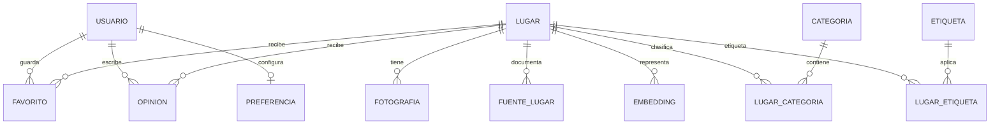

# Modelo de datos inicial

## Entidades y restricciones

- `usuario`: correo único, contraseña hasheada, rol y estado.
- `lugar`: nombre, descripción, dirección, contacto, estado de verificación, horarios, precios y duración opcionales, coordenadas opcionales.
- `categoria` y `lugar_categoria`: relación muchos a muchos.
- `etiqueta` y `lugar_etiqueta`: etiquetas normalizadas.
- `fotografia`: ubicación del recurso, texto alternativo, fuente, licencia y atribución.
- `fuente_lugar`: lugar, campo respaldado, URL de fuente, fecha de revisión y responsable.
- `favorito`: clave única `(usuario_id, lugar_id)`.
- `preferencia`: máximo una fila por usuario.
- `opinion`: autor real, lugar, calificación 1–5, texto y moderación; una opinión por usuario y lugar.
- `embedding`: lugar, modelo/digest, dimensión y vector. Inicio con `vector(1024)` solo tras congelar el modelo de embeddings.

## Tipos e índices

- Coordenadas en `geography(Point,4326)`, nullable hasta contar con ubicación verificada.
- GiST para la columna geográfica; B-tree para estado/categoría/precio; GIN para búsqueda textual.
- pgvector con similitud coseno; búsqueda exacta al inicio y HNSW cuando el conjunto y las mediciones lo justifiquen.
- CHECK para rating y rangos numéricos; FKs para todas las relaciones; fichas públicas filtradas por estado.

Los datos desconocidos permanecen `NULL` o con estado pendiente. Los datos de pruebas sintéticos, si se agregan, se aíslan de la carga de producción. No se crearán lugares, fotos, precios u horarios ficticios como contenido del catálogo.
